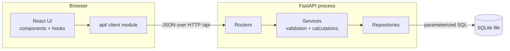

# Implementation Plan: SpendWise Personal Expense Tracker

**Branch**: `001-spendwise-expense-tracker` | **Date**: 2026-11-13 | **Spec**: [spec.md](spec.md)

**Input**: Feature specification from `specs/001-spendwise-expense-tracker/spec.md`

## Summary

SpendWise is a single-user web app for recording expenses, filtering them, tracking a per-month
budget, and viewing a monthly dashboard. A React (Vite, TypeScript) single-page UI calls a FastAPI
backend over a small REST API. The backend validates everything with Pydantic plus pure parsing
functions, does all money arithmetic with exact integers and `Decimal`, and stores data in a local
SQLite file. The design is deliberately small (two tables, seven endpoints, one screen) so that it
can be built and tested by 2026-11-15 while meeting every functional requirement (FR-001 to FR-040)
and success criterion (SC-001 to SC-010) in the spec.

Supporting artifacts: [research.md](research.md) (decisions D-01 to D-18 and resolved decisions
P-1 to P-3), [data-model.md](data-model.md), [contracts/api.md](contracts/api.md),
[quickstart.md](quickstart.md).

## Technical Context

**Language/Version**: Python 3.12 (backend); TypeScript 5.x with React 18 or 19 (frontend, Vite
`react-ts` template, `strict` on); Node.js 24

**Primary Dependencies**: FastAPI, Uvicorn, Pydantic v2 (bundled with FastAPI); React, Vite; dev:
Pytest, pytest-cov, httpx, Ruff, Bandit, Vitest, React Testing Library, jsdom

**Storage**: SQLite file via the standard-library `sqlite3` module; versioned SQL migrations

**Testing**: Pytest (unit and API tests with `TestClient`), Vitest + React Testing Library
(frontend), manual walkthroughs from [quickstart.md](quickstart.md) for responsive layout,
performance, and SC-010

**Target Platform**: Local single-user machine (Windows development); modern desktop and mobile
browsers, 360 px to 1440 px wide

**Project Type**: Web application (separate `frontend/` and `backend/`)

**Performance Goals**: List and dashboard visible within 2 s with 1,000 expenses (SC-005), verified
by a manual end-to-end check (SC-005a) and an automated in-process check that list-all and
monthly-summary each take under 500 ms (SC-005b); figures update within 1 s after a change
(SC-004).

**Constraints**: Exact money arithmetic (no `float`); deterministic summaries; backend is the sole
validation authority; no secrets in source; no authentication, bank integration, payment
processing, or cloud deployment; deadline 2026-11-15

**Scale/Scope**: One user, up to about 1,000 expenses, 1 screen, 7 endpoints, 2 tables

## Constitution Check

*GATE: Passed before research and re-checked after design. Source: `.specify/memory/constitution.md`
v1.1.0 (amended 2026-11-13).*

| Principle / Gate | How the design complies | Status |
|------------------|-------------------------|--------|
| I. Reliability and correctness | Exact `Decimal` parsing from text in one shared `core/money.py`; integer cents in all calculations and in SQLite `INTEGER`; amounts serialized as two-decimal strings; amounts with more than two decimal places (expense or budget) are rejected and never rounded, and no rounding mode is used on user input (the old `ROUND_HALF_UP` rule was removed by the v1.1.0 amendment); no `float`; summaries are pure functions of stored rows with an injectable clock (D-05, D-06, D-09, D-13) | Pass |
| II. Simplicity and usability | One screen; add/edit/delete/filter each within 3 interactions (P-3); loading and error states in every async component; labelled, keyboard-reachable controls; responsive CSS | Pass |
| III. Data integrity | Backend validates all rules in the spec; 422 with structured errors; category list defined once; SQLite `CHECK` constraints; transactions; versioned migrations (D-07, D-10, D-11) | Pass |
| IV. Security | Pydantic validation plus sanitization; parameterized SQL only; no raw HTML rendering; secrets via environment, `.env.example` committed, `.env` and `*.db` git-ignored; explicit CORS origins; generic 500 body; pinned dependencies (D-14, D-15) | Pass |
| V. Testability | Pure validation and calculation modules; every endpoint tested for success and each failure class; per-test temporary database and fixed clock | Pass |
| VI. Maintainability | Fixed stack; Yarn as the frontend package manager with `yarn.lock` retained; layers `routers -> services -> repositories`; `api/` client module in frontend; reusable components | Pass |
| VII. Development standards | Type hints enforced by Ruff `ANN`; Pydantic request/response models with `response_model`; Ruff, Bandit, Pytest configured in `backend/pyproject.toml` | Pass |
| G1 to G4 | Configured and runnable with the commands in [quickstart.md](quickstart.md) | Pass (by design) |
| G5, G6 | Coverage thresholds set in `backend/pyproject.toml` (`fail_under = 80`); services and core are pure, so 90% is realistic | Pass (by design) |
| G7 | `tests/unit/test_no_float.py` parses money-related modules with `ast` and fails on any `float` name or literal | Pass (by design) |
| G8 | `yarn build` in `frontend/` (`tsc -b && vite build`), as named in constitution v1.1.0 | Pass (by design) |
| G9 | `.gitignore` covers `.env`, `*.db`, `.venv`, `node_modules`, `dist`; the review covers the complete working tree plus the redacted output of `harness/scan_repo.py`, not only `git diff`, because new files are untracked | Pass (by design) |
| G10 | Validation matrix tests in `tests/api/` and `tests/unit/test_validation.py` cover every Principle III rule | Pass (by design) |

Post-design re-check: no new violations. One deliberate refinement: the database `CHECK` on amounts
is `> 0` rather than the constitution's example `>= 0`, because the spec forbids zero (stricter, not
weaker).

## Project Structure

### Documentation (this feature)

```text
specs/001-spendwise-expense-tracker/
├── spec.md
├── plan.md              # This file
├── research.md          # Decisions D-01..D-18, resolved P-1..P-3
├── data-model.md        # Entities, schema, validation messages
├── quickstart.md        # Setup, gates, validation scenarios, SC-010 walkthrough
├── contracts/
│   └── api.md           # REST contract
├── checklists/
│   └── requirements.md
└── tasks.md             # Created later by /speckit-tasks
```

### Harness and evidence (repository root: `Part-1A`)

```text
harness/                      # Independent of backend/ and frontend/; read-only for the coding agent
├── cases/                    # Expected cases derived from the spec before implementation (JSON)
├── run_api_checks.py         # Black-box HTTP checks, Python standard library only
├── scan_repo.py              # float scan (G7), tracked-files check (G9), secret-pattern aid (supplementary)
└── run-harness.ps1           # Runs every check, captures stdout, stderr, exit code, timings
harness-log.md                # Rules, run history, failures, repairs, decisions, human checks
evidence/
├── README.md                 # Explains the folders (supplementary)
├── initial-generation/       # Run 1: first complete generation, before any repair; never overwritten
├── snapshots/                # Copies of the source tree: initial-generation-source/, after-repair-NN-source/, final-generation-source/
├── repairs/                  # run-0-*, repair-NN-prompt/summary/changes/diff, rerun-NN/ evidence
└── final-generation/         # Last run of the same checks after repairs
```

Repair changes are captured without requiring a Git commit: the source tree is copied to a
snapshot at freeze time and after each repair, and each repair is described by a SHA-256 manifest
comparison (added, removed, and modified files, including new untracked files) plus a text diff of
the snapshot against the repaired tree. Snapshots, manifests, diffs, and run folders exclude `.env`, `.env.*` (except `.env.example`), `*.log`, `yarn-error.log`, and `*.db` files, and they are written by the independent operator, never by the coding agent.

### Source Code (repository root: `Part-1A`)

```text
backend/
├── pyproject.toml            # Ruff, Pytest, coverage, Bandit settings
├── requirements.txt          # Runtime dependencies, pinned
├── requirements-dev.txt      # Includes requirements.txt plus test and lint tools, pinned
├── .env.example              # Reference list of environment variables (not loaded by the app)
├── app/
│   ├── main.py               # create_app() and module-level `app = create_app()` (uvicorn app.main:app); migrations run in the startup hook, never at import
│   ├── core/
│   │   ├── config.py         # Settings from environment variables; default_db_path, resolve_db_path, same_path
│   │   ├── constants.py      # CATEGORIES, PAYMENT_METHODS, LIMITS (single definition)
│   │   ├── money.py          # single owner of amount-text parsing, digit/decimal checks, str <-> cents, formatting
│   │   ├── clock.py          # get_today() dependency
│   │   └── errors.py         # ValidationFailure, NotFound, exception handlers
│   ├── schemas/              # Pydantic request/response models
│   │   ├── expense.py
│   │   ├── budget.py
│   │   ├── summary.py
│   │   ├── meta.py           # /api/config response
│   │   └── errors.py         # Error response model
│   ├── routers/
│   │   ├── meta.py           # GET /api/config
│   │   ├── expenses.py
│   │   ├── budgets.py
│   │   └── summary.py
│   ├── services/
│   │   ├── validation.py     # Pure rules: check order and messages for amount and budget (calling money.py), date, month, description, enums
│   │   ├── calculations.py   # Pure: totals, per-category, remaining, over-budget
│   │   ├── expense_service.py
│   │   ├── budget_service.py
│   │   └── summary_service.py
│   ├── repositories/
│   │   ├── expense_repository.py
│   │   └── budget_repository.py
│   └── db/
│       ├── connection.py     # Per-request connection dependency
│       ├── migrate.py        # Applies migrations/*.sql in order
│       └── migrations/
│           └── 001_initial.sql
├── scripts/
│   ├── __init__.py           # makes `scripts` a package (imported as `scripts.seed`)
│   └── seed.py               # Deterministic data in September, October, and November 2026 (dates up to 2026-11-12): required --count N and --db PATH; refuses the default application database in any path spelling and any existing non-empty file
└── tests/
    ├── conftest.py           # Fixed today (2026-11-12), temp DB, client factory
    ├── unit/
    │   ├── test_money.py
    │   ├── test_validation.py
    │   ├── test_calculations.py
    │   ├── test_db_constraints.py
    │   ├── test_config_paths.py
    │   ├── test_seed.py
    │   └── test_no_float.py
    └── api/
        ├── test_config_api.py
        ├── test_security.py
        ├── test_expenses_api.py
        ├── test_filters_api.py
        ├── test_budgets_api.py
        ├── test_summary_api.py
        ├── test_summary_dataset.py
        ├── test_persistence.py
        └── test_performance.py

frontend/
├── package.json              # scripts: dev, build, lint, test
├── vite.config.ts            # /api proxy, Vitest config
├── tsconfig*.json            # strict
├── index.html
└── src/
    ├── main.tsx
    ├── App.tsx
    ├── api/                  # The only place that calls fetch
    │   ├── client.ts         # request(), ApiError with field errors
    │   ├── types.ts
    │   ├── config.ts
    │   ├── expenses.ts
    │   ├── budgets.ts
    │   └── summary.ts
    ├── hooks/
    │   ├── useConfig.ts
    │   ├── useExpenses.ts
    │   └── useSummary.ts
    ├── components/
    │   ├── common/           # Button, FormField, SelectField, ErrorBanner,
    │   │                     # LoadingIndicator, EmptyState, ConfirmDialog, MonthPicker
    │   ├── dashboard/        # DashboardSection, SummaryCards, CategoryBreakdown
    │   ├── budget/           # BudgetPanel, OverBudgetAlert
    │   └── expenses/         # ExpensesSection, ExpenseFilters, ExpenseList, ExpenseRow,
    │                         # ExpenseForm
    ├── utils/
    │   ├── formatMoney.ts    # String-only: "10000.00" -> "₹10,000.00"
    │   ├── formatDate.ts     # "2026-11-10" -> "10 Nov 2026" (fixed month names)
    │   └── month.ts          # Month string helpers (no Date arithmetic on money)
    ├── styles/app.css
    └── test/setup.ts

.gitignore                    # .env, *.db, .venv, node_modules, dist, coverage
README.md                     # Setup, run, lint, security, test commands
```

**Structure Decision**: Two top-level directories (`backend/`, `frontend/`) as required by the
constitution. The backend layers match constitution VI. The frontend separates API access, hooks,
and components, and has no router because there is only one screen.

## 1. High-Level Architecture



- **Development**: Vite serves the UI on `localhost:5173` and proxies `/api` to Uvicorn on
  `127.0.0.1:8000`. There is no cross-origin traffic; CORS still allows only listed origins.
- **Request flow (add expense)**: form submit -> `api/expenses.createExpense` -> `POST
  /api/expenses` -> Pydantic model calls pure parsers -> service checks the date against
  `get_today()` -> repository inserts inside a transaction -> 201 with the expense -> UI bumps a
  `version` counter -> `useExpenses` and `useSummary` refetch, so list, totals, budget, and warning
  update without a manual refresh (FR-036).
- **Error flow**: any failure becomes the single error body in [contracts/api.md](contracts/api.md);
  `ApiError` carries `errors[]`; forms show each message beside its field.
- **Money flow**: user text -> backend string parser -> integer cents in SQLite -> two-decimal
  string in the response -> frontend formats the string. No `float` anywhere (D-03, D-05, D-06).
- **"Today"**: the backend reads the local date at request time (`core/clock.py`), returns it in
  `GET /api/config`, and uses the same value for future-date validation; the UI uses it for the
  default month and the date input's `max`. Tests override it with `2026-11-12` (P-1, FR-041).

## 2. Folder Structure

See [Project Structure](#project-structure). Each backend layer imports only from layers to its
right in `routers -> services -> repositories`, plus `schemas` and `core`.

## 3. Database Schema

Full DDL and rules are in [data-model.md](data-model.md). Summary:

| Table | Columns | Keys and constraints |
|-------|---------|----------------------|
| `expenses` | `id`, `amount_cents`, `description`, `category`, `payment_method`, `expense_date`, `created_at`, `updated_at` | PK `id`; `CHECK amount_cents` in 1..999,999,999; `CHECK` description length 1..200; `CHECK` ISO date shape; indexes on `(expense_date DESC, id DESC)` and `category` |
| `monthly_budgets` | `month`, `amount_cents`, `updated_at` | PK `month` (one budget per month); `CHECK` month shape; `CHECK amount_cents` in 1..9,999,999,999 |
| `schema_migrations` | `version`, `applied_at` | Written by the migration runner |

Budgets are in the same SQLite file as expenses, so they persist across restarts (FR-005).

## 4. REST API

Full contract with examples: [contracts/api.md](contracts/api.md).

| Endpoint | Request responsibility | Response responsibility |
|----------|------------------------|-------------------------|
| `GET /api/config` | None | `today`, currency, categories, payment methods, limits |
| `GET /api/expenses?month&category` | Validate optional filters | Expenses ordered by date then id, newest first; `[]` if none |
| `POST /api/expenses` | Validate five required fields | 201 created expense |
| `PUT /api/expenses/{id}` | Validate five fields; id must exist | 200 updated expense, or 404 |
| `DELETE /api/expenses/{id}` | id must exist | 204, or 404 |
| `PUT /api/budgets/{month}` | Validate month and amount | 200 saved budget (replaces previous) |
| `GET /api/summary?month` | Validate optional month | Totals, counts, per-category rows, budget, remaining, over-budget status |

## 5. Frontend Page and Component Structure

One page, `App`, with two sections. No router.

```text
App                         loads config; owns selectedMonth, list filters, version counter
├── DashboardSection        month picker (defaults to config.today's month)
│   ├── SummaryCards        total spent, expenses this month, all-time count
│   ├── BudgetPanel         budget form, Spent, Remaining or "No budget set for this month"
│   │   └── OverBudgetAlert warning with the overage amount (role="alert")
│   └── CategoryBreakdown   rows from /api/summary, or "No expenses recorded this month"
└── ExpensesSection
    ├── ExpenseFilters      month (clearable) and category ("All")
    ├── "Add expense" button -> ExpenseForm (modal panel, also used for edit)
    └── ExpenseList         loading / error / empty / "No expenses match these filters"
        └── ExpenseRow      Edit and Delete buttons -> ConfirmDialog for delete
```

- **State**: React hooks only. After any create, update, delete, or budget save, `App` increments
  `version`; hooks that depend on it refetch. The category filter does not affect the dashboard
  (FR-032).
- **Interaction counts (P-3, FR-043)**: one click, tap, or form submission is one interaction;
  typing and choosing values inside an open form are not counted. Add = click "Add expense",
  submit (2); edit = click Edit, submit (2); delete = click Delete, confirm (2); filter = choose a
  value (1); set budget = submit (1).
- **Duplicate prevention (FR-006, SC-009)**: the form's submit handler ignores calls while a
  request is pending and the Save button is disabled; the form is closed on success.
- **UX states (FR-040)**: `LoadingIndicator`, `ErrorBanner` (retry), and `EmptyState` are shared
  components used by list, summary, and config loading.
- **Display rules**: money strings pass through `formatMoney`; dates through `formatDate`; no
  number conversion. The over-budget alert states "Budget exceeded by ₹X" and Remaining shows
  `₹0.00`.
- **Accessibility and layout**: every input has a `<label>`; errors use `aria-describedby`; dialogs
  trap focus and close on Escape; CSS Grid with a single-column layout below about 640 px; the
  list becomes stacked cards on narrow screens, so there is no horizontal scrolling (FR-038).

## 6. Validation and Error Handling

- **Single source**: the backend. The UI performs no validation of its own beyond disabling Save
  while submitting; it displays backend messages (D-07, D-08).
- **Layers**: Pydantic models (shape, required, no extra fields) call pure parsers in
  `services/validation.py`; the service adds the date range rule using the injected clock; SQLite
  `CHECK` constraints back both up.
- **Messages**: exact wording per field and rule is in [data-model.md](data-model.md); all failing
  fields are returned together, one message each.
- **Atomicity**: validation runs before any write; writes use one transaction, so a rejected
  request leaves data unchanged (spec FR-014).
- **Error shape**: `{code, message, errors[]}` for 404, 422, and 500; 500 never exposes SQL, stack
  traces, or paths; details go to the server log only.
- **Sanitization (FR-042)**: `clean_description` replaces tab, line feed, and carriage return with
  one space, removes other control characters (Unicode category `Cc`), then trims; the 1 to 200
  length check applies to the cleaned text. `<`, `>`, `&`, quotes, accents, non-Latin scripts, and
  emoji are kept and rendered as plain text by React (D-14). SQL is parameterized; fragments for
  optional filters come only from fixed string constants.
- **Frontend errors**: `ApiError` with `errors[]` maps to form fields; network failures show
  "Could not reach the server. Try again." and keep the entered form values (spec Edge Cases).

## 7. Testing Strategy and Traceability

Fixtures: fixed reference date `2026-11-12` through the `get_today` override; a fresh temporary
SQLite file per test; no network. Frontend tests mock the `api/` module and pin `config.today` to
`2026-11-12`.

| Spec items | Verified by |
|------------|-------------|
| US1 #1 to #4, FR-001 to FR-004 | `test_expenses_api.py` (create, list order, update keeps id and count, delete 204, 404 on missing); Vitest `ExpenseForm`, `ExpenseList`, `ConfirmDialog` (display format, confirm and cancel) |
| US1 #5 to #8, #10 to #12, #14 to #17, #19 to #22; Edge Cases (amount, description, dates, payment); FR-007 to FR-015 | `test_validation.py` parametrized with every accepted and rejected value listed in the spec; `test_expenses_api.py` 422 checks of field, message, and unchanged database, including a malformed JSON body (field `body`) and unknown fields; Vitest shows backend messages beside fields |
| US1 #9, FR-006, SC-009 | Vitest: two rapid clicks on Save call the API once; API test: startup and GET calls insert zero rows |
| US1 #23 to #26, FR-042 | `test_validation.py` description table (special characters kept exactly; tab/LF/CR become one space; NUL and DEL removed; control-only and space-only input rejected as empty; 200 accepted and 201 rejected after cleaning); `test_expenses_api.py` round trip of `<b>Tom & "Jerry's"</b>` returned unchanged; Vitest renders it as text (no `<b>` element in the DOM) |
| US1 #5, #6, #27, FR-007, FR-015 | `test_validation.py` (`0`, `0.00`, `-5` rejected, `0.01` accepted); `test_db_constraints.py` inserts `amount_cents` of `0`, `-1`, and `1000000000` into `expenses`, and `0`, `-1`, and `10000000000` into `monthly_budgets`, directly through the repository or raw connection and asserts the database raises an integrity error and no row exists |
| US1 #13, US3 #10, FR-005, SC-008 | `test_persistence.py`: write with one app instance, open a second instance on the same file, assert expenses and budgets unchanged |
| US1 #18, US2 #1, FR-016, FR-017 | `test_config_api.py` (exact lists); Vitest selects render exactly those options |
| US2 #2 to #8, FR-018 to FR-022, SC-007 | `test_filters_api.py`: category, month, both, none, clear, month-boundary dates (`2025-12-31` vs `2026-01-01`), invalid category; Vitest empty-state message |
| US3 #1 to #7, #9, FR-023 to FR-027, SC-006 | `test_calculations.py` (spent, remaining, equal, one paisa over, no budget, no cross-month leakage); `test_budgets_api.py`; `test_summary_api.py`; Vitest `BudgetPanel` and `OverBudgetAlert` |
| US3 #8, #11 to #15, FR-024 | `test_validation.py` budget table (`0`, `-100`, empty, `abc`, `0.01`, `99999999.99`, `100000000.00`, `12000.999`, `12000`, `12000.5`); `test_budgets_api.py` asserts previous budget unchanged after each rejection, and also after a malformed JSON body (field `body`) or an unknown field in the budget request |
| US4 #1, FR-028, FR-041 | `test_summary_api.py` default month equals month of fixed today; `test_config_api.py` `today` equals the overridden date; `test_expenses_api.py` future-date check uses the same dependency (`2026-11-12` accepted, `2026-11-13` rejected, with the override changed to prove the check follows the backend date); Vitest default month and date `max` come from `config.today` |
| US4 #2 to #5, #8, #9, FR-029 to FR-031, FR-034, FR-037 | `test_calculations.py` and `test_summary_api.py`: `0.10 + 0.20 = 0.30`, per-category sums, ordering, zero-spend categories omitted, all-time count, repeated calls identical |
| US4 #6, #7, FR-036, SC-004 | `test_summary_api.py`: edit moves an expense between months and both summaries change; Vitest: after create, update, delete, and budget save the list and summary fetchers are called again; the 1-second limit of SC-004 is measured by hand in quickstart V15 (task T083) |
| SC-003 | `seed.py --count 50 --db <temp file>` dataset (50 expenses over September, October, and November 2026 and all 8 categories) with expected totals written as constants in `test_summary_dataset.py` (computed by hand, not by the code under test); `test_seed.py` checks the exact count, all 8 categories, determinism, and that only the `--db` file is written (the default application database is never touched) |
| SC-005a, SC-005b | SC-005b: `test_performance.py` seeds 1,000 expenses with the fixed date and, after one warm-up call, times list-all and monthly summary separately, each under 500 ms; it measures in-process server work only. SC-005a: manual run V10 in [quickstart.md](quickstart.md) (5 cache-disabled loads, navigation start until list and dashboard are visible, every run within 2 s); it includes rendering and the local network |
| FR-038, FR-039, FR-043, SC-001 | Manual runs V9, V11, and V14 (the 30-second limit of SC-001, timed by hand) in [quickstart.md](quickstart.md); Vitest asserts the interaction counts for add (2), edit (2), delete (2), filter (1), and set budget (1) by counting clicks and submits in `user-event` flows |
| FR-040 | Vitest: loading indicator while pending, error banner on failure, form values kept after failed save |
| SC-002 | The parametrized tables above are generated from one list of accepted and rejected inputs, so none is missed |
| SC-010 | One scripted pass/fail walkthrough (add expense, set budget, open dashboard) by a reviewer other than the author, or by an automated end-to-end UI test against the real backend; steps, interaction counts, and expected versus observed figures recorded in `harness-log.md`. It is not a usability study and supports no percentage claim. Component tests that mock the API do not count (see [quickstart.md](quickstart.md)). Playwright is optional |
| Constitution G7 | `test_no_float.py` |
| Security (constitution IV) | Bandit; API test that unexpected errors return the generic 500 body; test that `<script>` in a description is stored and returned unchanged as plain text |

Coverage targets: backend >= 80% overall and >= 90% for `app/services` and `app/core`; frontend
coverage is not gated.

## 8. Local Development and Setup

Full commands, environment variables, and validation scenarios are in
[quickstart.md](quickstart.md). In short, from the repository root in PowerShell:

```powershell
python -m venv .venv; .\.venv\Scripts\Activate.ps1
pip install -r backend/requirements-dev.txt
cd frontend; yarn install --frozen-lockfile; cd ..
uvicorn app.main:app --reload --app-dir backend --host 127.0.0.1 --port 8000   # terminal 1
cd frontend; yarn dev                                                             # terminal 2
```

Quality gates: `ruff check backend`, `ruff format --check backend`, `bandit -r backend/app -ll`,
`pytest backend --cov=app --cov-fail-under=80`, and in `frontend/`: `yarn build`, `yarn lint`,
`yarn test`. The independent harness is run with `.\harness\run-harness.ps1 -OutDir <folder>`; see
[quickstart.md](quickstart.md).

## 9. Key Technical Decisions

Full rationale and alternatives are in [research.md](research.md).

| ID | Decision | Why |
|----|----------|-----|
| D-01 | TypeScript for the frontend | Typed API responses catch mismatches at no extra setup cost |
| D-02 | One screen, hooks only, plain CSS | Smallest tool set that satisfies the spec |
| D-03 | Frontend never converts money to `number` | End-to-end exactness |
| D-04 | `sqlite3` with hand-written parameterized SQL | Two tables; no ORM overhead |
| D-05 | Store integer cents | Exact sums and simple range checks |
| D-06 | Strict string-only money parsing | Reproduces every spec edge case and message; no float entry point |
| D-07 | Three-layer validation (parsers, service, DB checks) | Pure, unit-testable rules with a database backstop |
| D-08 | One error body shape | UI maps messages to fields directly |
| D-09 | Injectable clock; backend date shared with the UI (P-1) | Deterministic tests and one source of "today" |
| D-10 | Versioned SQL migrations | Constitution requirement, minimal code |
| D-11 | Category and payment lists defined once | Constitution requirement; served to the UI |
| D-13 | Pure calculation module; `remaining` clamped to `0.00` plus `over_budget_by` | Matches spec wording; easy to test |
| D-15 | Vite proxy and explicit CORS origins | No CORS issues, no wildcard |
| D-16, D-17 | Vitest + RTL; reviewer walkthrough for SC-010 | Cheapest verifiable options |

## Open Items

None. The three decisions raised during `/speckit-clarify` are resolved as P-1, P-2, and P-3 in
[research.md](research.md) and written into the spec (FR-041, SC-005, FR-043).

## Complexity Tracking

No constitution violations remain. The two earlier items were resolved by constitution amendment v1.1.0 (2026-11-13, task T008): Principle I now requires exact `Decimal` parsing, integer cents, and rejection of amounts with more than two decimals (the mandatory `ROUND_HALF_UP` rule was removed), and Yarn with `yarn.lock` replaces npm with `package-lock.json` in Principle IV, Principle VI, and gate G8.

One refinement is recorded rather than a violation: the database `CHECK` on amounts is `> 0`, which is stricter than the constitution's example `>= 0`.

No additional projects, services, or abstractions beyond the layers the constitution requires. The
`harness/` and `evidence/` folders are verification tooling outside the application, not
application code.


## Implementation Notes (T017 to T073)

Decisions and deviations recorded while the first generation was built. None weakens a requirement, a validation rule, or a test.

- **Frontend lint and test tooling (T006)**: `yarn lint` runs `oxlint --deny-warnings` (the current Vite template's linter) instead of ESLint; `jsdom` is pinned to major 28 because jsdom 29 needs Node 24.15 or later; `@testing-library/dom` was added because React Testing Library and jest-dom need it as a peer dependency.
- **Request shape versus rules**: `ExpenseIn` and `BudgetIn` check only the shape (string fields, no unknown fields). Every rule and message lives in `services/validation.py`, and `ExpenseIn.to_valid(today)` runs all five field parsers so every failing field is reported together, then checks the date range against the injected "today". A JSON number sent as an amount is rejected with the amount message ("Enter a valid amount", or the budget message for budgets) and is never converted.
- **Whitespace-only amount**: `money.analyze_amount_text` reports whitespace as empty; `parse_amount` maps a missing or truly empty amount to "Amount is required" and a whitespace-only amount to "Enter a valid amount", as T034 specifies.
- **Not-found handling**: a non-integer or out-of-range expense id returns the normal 404 body; an unknown route returns a 404 body with code `not_found`; other HTTP errors use code `http_error`.
- **Select placeholders and dates in the expense form**: the category and payment-method selects have an empty placeholder option (not counted as one of the offered values) and the date starts empty, so submitting an empty form shows one message beside each of the five fields (US1 #8).
- **Display**: amounts use groups of three digits (`₹9,999,999.99`) and dates use `DD Mon YYYY`; the expense row switches to a one-line layout when its section is at least 720 px wide (container query), so there is no horizontal scrolling from 360 px to 1440 px.
- **Summary build order**: `GET /api/summary` was first built with the budget figures (T058) and extended with `by_category` and `total_recorded_count` (T067), following the task order.
- **SQL**: every query is a fixed string with `?` placeholders (the filter combinations are four fixed queries), which also keeps Bandit clean.
- **Seed script**: the generator rules are written in the docstring of `backend/scripts/seed.py` (category by index, payment method by index, date from 2026-09-01 plus `(i * 29) % 73` days, amount 10.00 plus `(i * 7919) % 99000` cents); it inserts in one transaction through `expense_repository.insert_many`.
- **Working checks (T046, T052, T061, T069)**: besides the automated tests, the quickstart scenarios V1 to V8, V12, and V13 were walked through with an automated browser session against the real backend (including a 50-expense seed database and a backend restart for V4). This is the generation's own check, not harness evidence. Scenarios V9 (manual responsive review; only an automatic no-horizontal-overflow check at 360, 768, and 1440 px was run), V10, V11, V14, V15, and the SC-010 walkthrough remain human tasks (T083, T084).